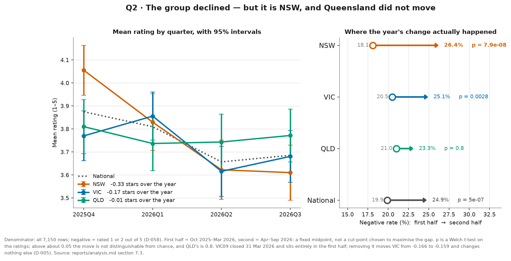
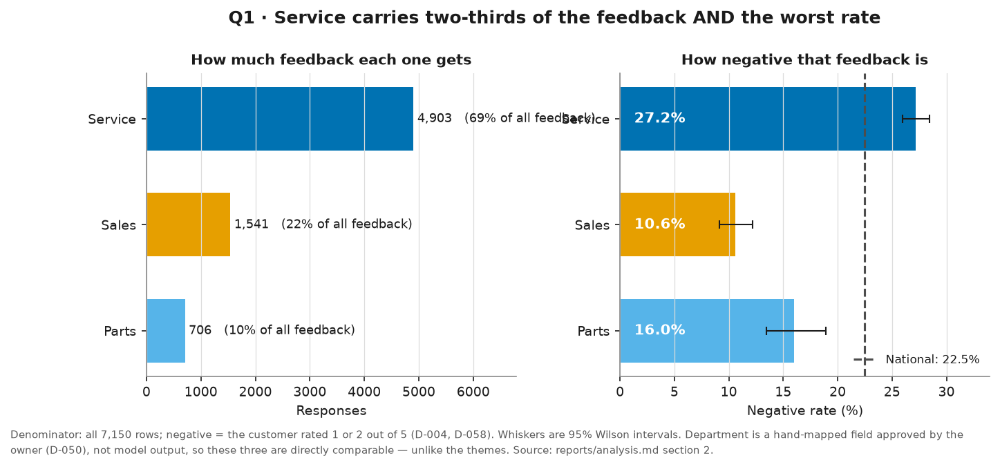
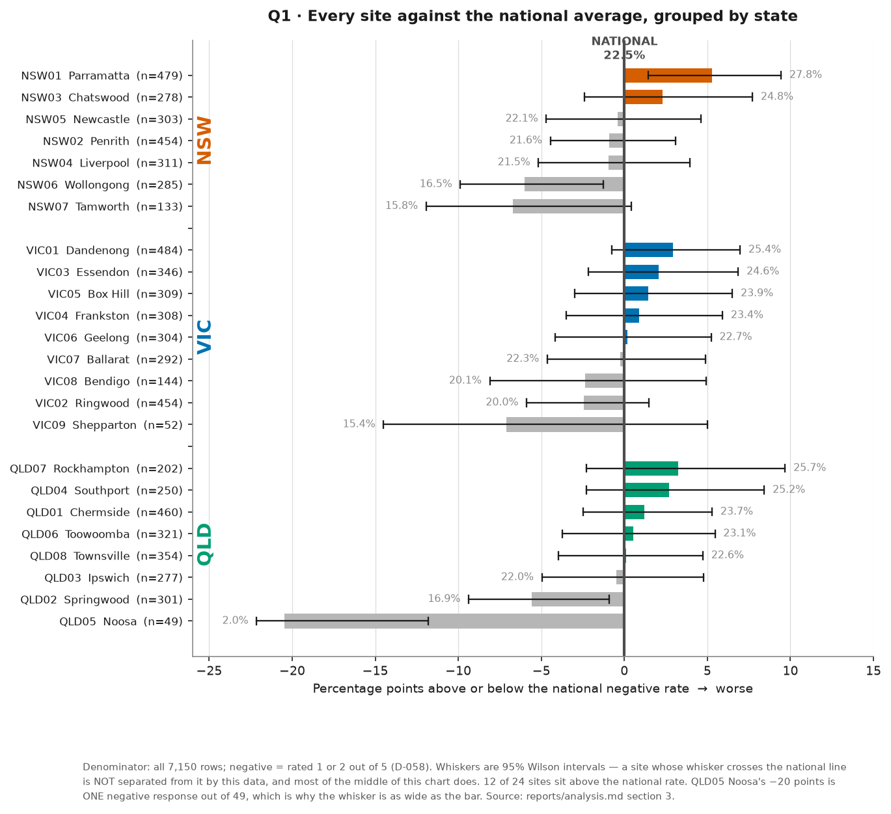
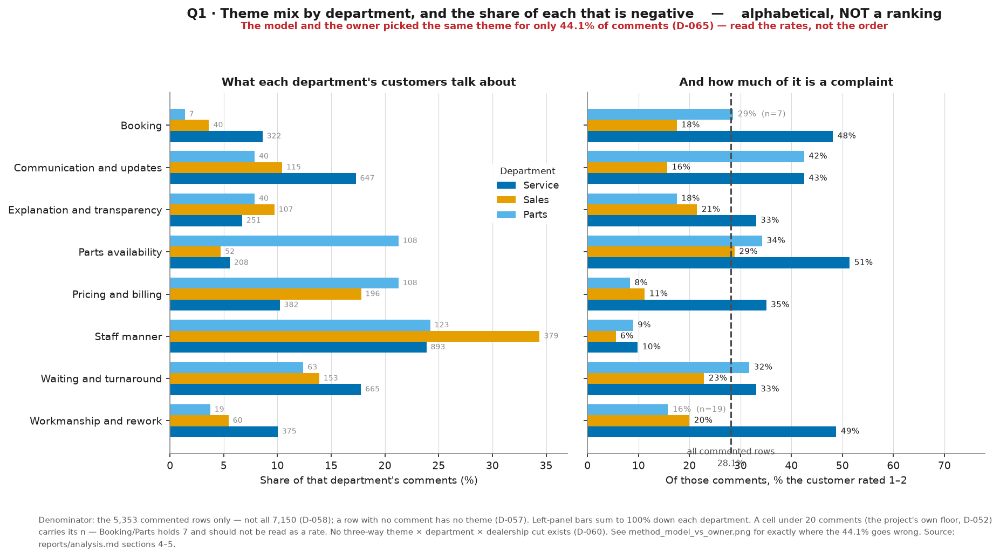
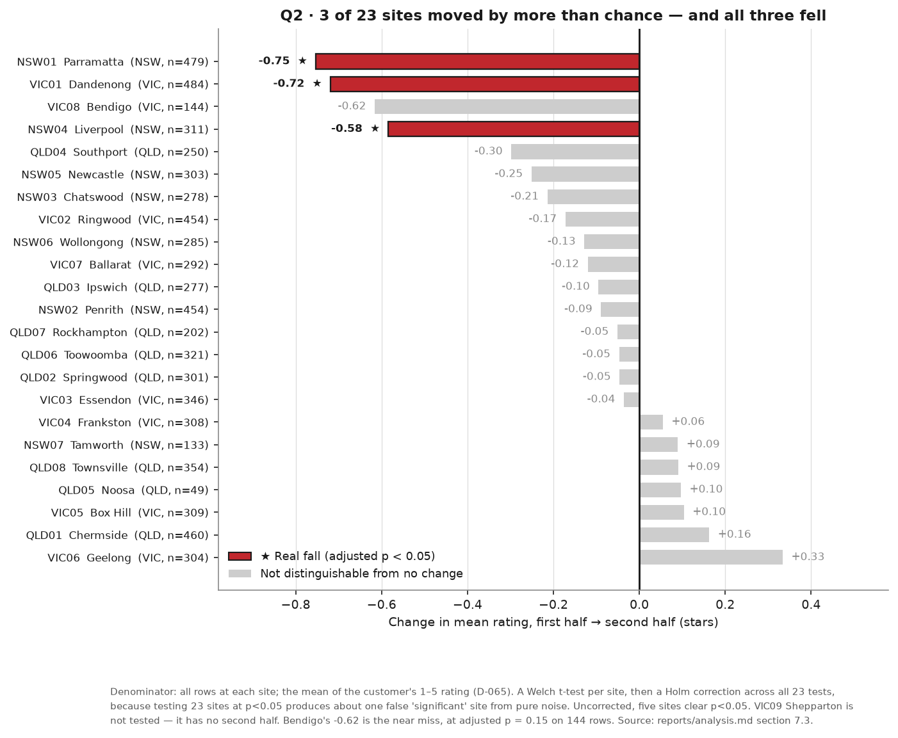
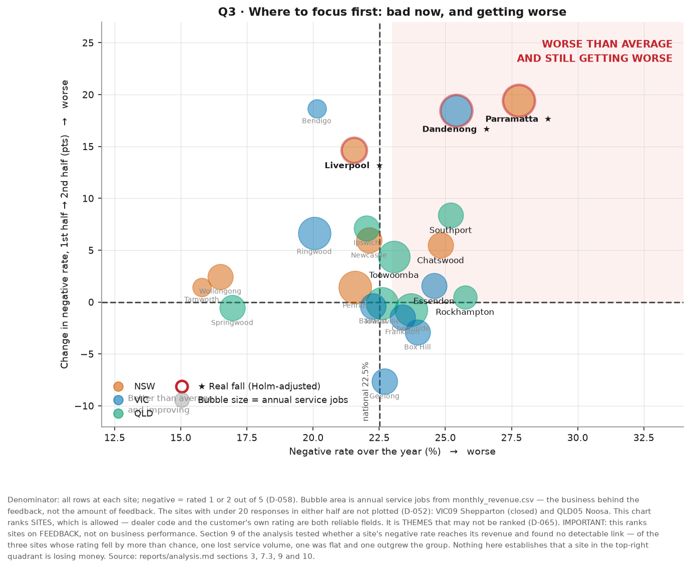
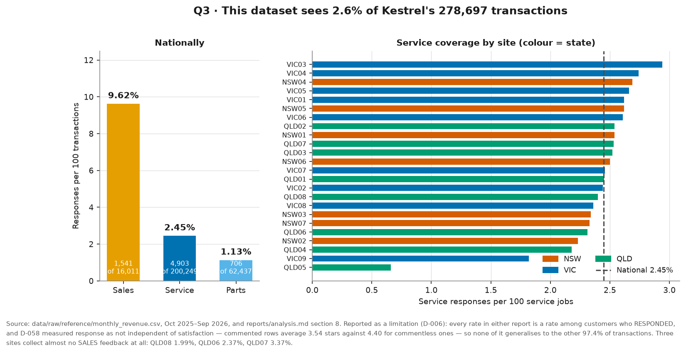
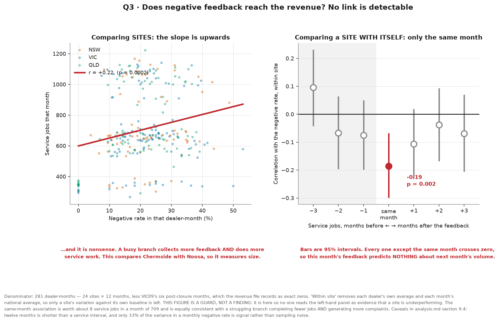
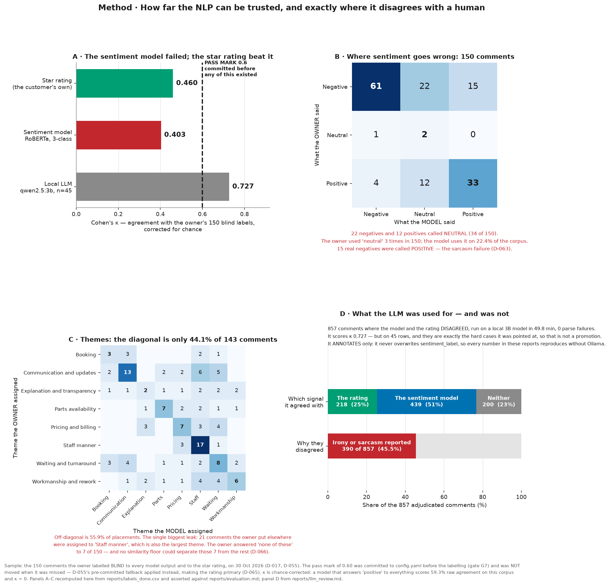

# Customer feedback, October 2025 – September 2026

**For:** the Head of Customer Experience, Kestrel Motor Group
**From:** gdawg95 · **Date:** 30 October 2026
**Status: final, 30 October 2026.** Figures approved under gate G9 and the recommendations
rewritten in the owner's own voice, which closes both halves of PLAN.md Checkpoint 5. Every
number in this report was independently recomputed from the raw data by a separate agent
that wrote none of it (`agents/reports/w5_verify.md`).

Every number comes from [`reports/analysis.md`](analysis.md), which shows the working, and
from code a reviewer can run (`make analyse`). Method, data quality and limitations are in
the technical report, [`README.md`](../README.md).

---

## 1. The short version

**52 spreadsheets from 24 dealerships became one dataset of 7,150 responses**, 5,353 of them
carrying a written comment. Four things in it are worth your time.

**One. Across the year, 22.5% of responses were negative** — a rating of 1 or 2 out of 5,
over all 7,150 responses. You will see 28.1% quoted elsewhere in this project: that is the
same measure over only the 5,353 responses that carry a comment. The two are 5.6 points apart
because unhappy customers write and happy ones tick five and leave. **Both are true; they
answer different questions.** This report uses the 7,150 figure throughout and says so
wherever a rate appears.

**Two. Satisfaction fell over the year, and the evidence says it is real.** Mean rating
**3.84 → 3.67** across the two halves; negative rate **19.9% → 24.9%**. Not seasonal noise,
not the site that closed: three separate statistical tests put the odds of seeing this by
chance at under one in a million.

**Three — and this is the part that changes what you do about it. The decline is New South
Wales. Queensland did not move at all.**

| | Mean rating | Negative rate | Is the change real? |
|---|---|---|---|
| **NSW** (7 sites) | 3.95 → **3.62** | 18.1% → **26.4%** | **Yes — overwhelmingly** (p = 0.000000079) |
| **VIC** (9 sites) | 3.81 → 3.65 | 20.5% → 25.1% | Yes, but half the size (p = 0.0028) |
| **QLD** (8 sites) | 3.77 → 3.76 | 21.0% → 23.3% | **No** (p = 0.80) |

A single national number would have told your eight Queensland sites to fix a problem they do
not have, and understated New South Wales' by more than half.

*The year split three ways. New South Wales fell hard; Queensland did not move. The group average hides both.*

**Four. Underneath the state picture, it is Service.** Service is 68.6% of the feedback and
72% of the transactions behind it, and has the worst negative rate of the three departments
(27.2%). In NSW specifically, Service went from **21.7% to 32.1% negative** — ten points in
six months. NSW Sales also worsened by 8.5 points. NSW Parts improved.

**Five. We checked whether any of it reaches the money, and it does not — measurably.** Your
own revenue file is the only record of what customers actually *did*. NSW's satisfaction
collapsed and its service volume **grew 4.9%**. A month's negative rate does not predict the
next month's volume, or the month after. The full test is section 5, and the null result is
more useful than it sounds.

**And one thing this report does not tell you.** It does not put a dollar figure on the
problem. Section 6 — a deliberate omission, not an oversight, and section 5 is part of why.

---

## 2. What drives negative feedback

### By department — the reliable cut

**Denominator: all 7,150 responses. Negative = a rating of 1 or 2.**

| Department | Responses | Negative | Rate | Mean rating |
|---|---:|---:|---:|---:|
| **Service** | 4,903 | 1,333 | **27.2%** | 3.57 |
| Parts | 706 | 113 | 16.0% | 3.95 |
| Sales | 1,541 | 163 | 10.6% | 4.26 |

A customer coming in for a service is roughly **two and a half times** as likely to leave a 1
or 2 as a customer buying a car. This cut is trustworthy: the department label was mapped by
hand from 16 source spellings and every mapping was signed off. It is not a model's guess.

*Service carries two-thirds of the feedback and the worst rate. Bars are 95% confidence intervals.*

### By dealership

Twelve sites sit above the national 22.5% and twelve below. The important reading is that
**the middle of that list is not meaningfully ordered** — the confidence intervals overlap.
The sites that genuinely stand apart:

- **Parramatta (NSW01), 27.8% on 479 responses** — the highest rate at a site with the volume
  to be sure of it.
- **Noosa (QLD05), 2.0%** — but that is **one** negative response out of 49, collected against
  4,108 service jobs. The thinnest site in the dataset, not a model site.

`q1_sites_vs_national.png` plots all 24 as a distance from the national line, grouped by
state, with the intervals shown.

*Every site against the national line, grouped by state. Where a whisker crosses zero, that site is not separated from the national average by this data — which is most of the middle of the chart.*

### By theme — with a warning attached

Comments were sorted into eight themes by a local language model. **When the same comments
were sorted by hand, the model agreed on the theme only 44.1% of the time.** That governs what
may be said:

- A theme's negative rate **is** reportable, with the 44.1% stated.
- **"Theme X is a bigger problem than theme Y" is not**, and this report does not say it. A
  44%-reliable classifier cannot rank eight categories.

**What survives that caveat** is the coarsest split in the list: **staff manner is the largest
theme (1,395 comments) and by a wide margin the least negative (8.6%, against 28.1% across all
commented responses).** The complaints are not about the people. The recurring comment praises
the staff and criticises the process:

> *"Great welcome, helpful staff. Problem not fixed."*
> *"nice helpful staff, wait was too long tho"*
> *"Good people, very nice to deal with. Slow, slow, slow."*

*Which* part of the process is exactly what the 44.1% is uncertain about.

*What each department's customers talk about, and how much of it is a complaint. Alphabetical, never ranked — the model and a human agreed on the theme only 44.1% of the time.*

---

## 3. What changed over the year

| | Oct 2025 – Mar 2026 | Apr – Sep 2026 | Change |
|---|---:|---:|---:|
| Responses | 3,457 | 3,693 | |
| **Mean rating** | **3.84** | **3.67** | **−0.17 stars** |
| **Negative rate** (all responses) | **19.9%** | **24.9%** | **+5.0 points** |

**Why you can believe it.** The rule for calling a movement real was written into the project's
configuration *before* any trend result existed: a month needs 20 responses, and the smallest
change worth reporting is half a star. That rule was calibrated for one site in one month,
where random noise on a change is about ±0.46 stars. This finding is measured on 3,457
responses against 3,693, where the same arithmetic puts the noise at **±0.034 stars** — the
observed fall is five times that. Three different tests agree, each at p < 0.0001.

**What it is not.**

- **Not the closed site.** Shepparton (VIC09) shut on 31 March 2026, so all its responses fall
  in the first half — exactly the kind of change that can fake a trend. Removing it moves the
  fall from −0.171 to −0.169 stars.
- **Not a change in who responds.** Department mix is stable (Service 69.3% → 67.9%) and
  monthly volume is within 7% across the halves.
- **Not one bad site dragging the group.** At site-month level the committed rule finds 33
  movements across 16 sites, splitting **16 down, 17 up** — no direction at all. The decline
  only appears when the data is pooled.

### Where it actually is

**By state** — see section 1. NSW −0.33 stars, VIC −0.17, QLD −0.01 and not significant.

**Inside NSW, by department:**

| | First half | Second half | Change |
|---|---:|---:|---:|
| **NSW Service** | 21.7% negative | **32.1%** | **+10.3 points** (p = 0.0000003) |
| NSW Sales | 7.8% | 16.4% | +8.5 points (p = 0.0007) |
| NSW Parts | 19.2% | 14.7% | −4.5 points — improved |

**By individual site.** Testing 23 sites for a change creates a trap: at the usual threshold,
roughly one site in twenty looks "significant" with nothing happening. After correcting for
that, **three sites moved by more than chance — and all three fell. None improved.**

| Site | Change | Adjusted p |
|---|---:|---:|
| **NSW01 Parramatta** | −0.75 stars | 0.0000014 |
| **VIC01 Dandenong** | −0.72 stars | 0.0000013 |
| **NSW04 Liverpool** | −0.58 stars | 0.0057 |

*Every site's move, with the three that survive correction for testing 23 sites at once marked in red. Grey bars are not distinguishable from no change.*

Bendigo (VIC08) is the near miss at −0.62 and adjusted p = 0.15 on 144 responses — worth a
look, not worth a claim.

---

## 4. Recommendation

### There are two different problems here

**One: Service, everywhere.** 68.6% of the feedback, 72% of the
transactions, and the worst negative rate of the three departments at 27.2%. That is true in
all three states and it has been true all year. It is a structural issue with the service
experience, not an incident.

**Two: New South Wales, and it is six months old.** NSW Service went from 21.7%
to 32.1% negative while Queensland did not move. Something changed in NSW between March and
April 2026, and the data says *where* without saying *what*.

### Focus first: NSW Service, starting with Parramatta and Liverpool

*Bad now (right) against getting worse (up), sized by the service business behind each site. **This ranks sites on feedback, not on business performance** — see section 5.*

| | Number | Section |
|---|---:|---|
| Service's share of all feedback | **68.6%** (4,903 of 7,150) | 2 |
| Service's share of the transactions behind it | **71.9%** (200,249 of 278,697) | 8 |
| Service's negative rate | **27.2%**, worst of three departments | 2 |
| NSW Service's deterioration | **+10.3 points** (21.7% → 32.1%), p = 0.0000003 | 7.3 |
| Sites that fell by more than chance | **Parramatta, Dandenong, Liverpool** — all falls | 7.3 |

Parramatta and Liverpool are both NSW and both survive the statistical correction, so they are
where the state story and the site story agree. Parramatta is also the second-largest service
site in NSW (12,265 jobs a year, fifth of 24 nationally); Liverpool is mid-sized (7,654 jobs,
fifteenth of 24), so it earns its place on the strength of its change rather than its size. **Dandenong (VIC01) is the third and sits
outside NSW** — it belongs on the list on its own evidence, not because of the state pattern.

Nothing in that chain depends on the sentiment model, which failed its accuracy test, or on
the theme model, which is 44% reliable. It rests on the customer's own star rating, a
hand-mapped department field, and your transaction counts.

**The supporting steer (not a finding):** the comments often praise the human interactions but criticise the process (ie. themes like booking/service times/parts availability).
If that holds when you read them, the useful interventions are
operational — turnaround time, keeping customers informed, whether the job is right first time
— rather than customer-service training for staff who are being thanked by name.

### Second, cheaper recommendation: fix the collection, not just the service.

**This dataset sees 2.57% of Kestrel's transactions** — 7,150 responses against 278,697
service jobs, vehicle sales and parts transactions. The coverage is also wildly uneven:

- Service feedback runs at **2.45%** of jobs nationally, from 0.66% (Noosa) to 2.94%
  (Essendon).
- Sales feedback runs at **9.62%** nationally — but **Townsville collects 8 responses on 403
  sales (1.99%), Toowoomba 9 on 379 (2.37%) and Rockhampton 7 on 208 (3.37%)**. Those three
  sites are not measuring their sales experience at all.

*How little of the business this dataset sees. Three Queensland sites collect almost no sales feedback at all.*

Three sites with effectively no sales feedback is a cheap fix. Until it is fixed, any
comparison involving their Sales numbers compares a measurement with an absence.

**One caution on both recommendations.** Every rate here is a rate *among customers who
responded*, and response is not independent of satisfaction — people who left a comment
average 3.54 stars against 4.40 for those who did not. These rates are not the view of
Kestrel's customers generally, and this report deliberately does not scale them onto the 97.4%
of transactions that produced no feedback.

---

## 5. Does any of it reach the revenue?

**The question underneath this whole report: are these customers acting on their
dissatisfaction, or complaining without consequence?** `monthly_revenue.csv` — 288
dealer-months of service jobs, vehicle sales and the dollars attached — is the only record
in the project of what customers actually did, rather than what they said.

*The left panel is the correlation most people reach for, and it measures site size, not service quality. The right panel is the answer: only the same month is significant, so feedback predicts nothing about next month's volume.*

**The answer is that no link is detectable in twelve months of your data.** Three tests, all
in [`analysis.md` section 9](analysis.md):

**One. The obvious correlation is backwards.** Across all sites, more negative feedback goes
with *more* service volume (r = +0.22). That is sites' size, not their service: busy branches
generate both. Comparing each site against its own monthly average instead flips the sign to
r = −0.19 — a real but small association, worth about **8 service jobs in a month of 709**,
or 1.1%.

**Two. It is a same-month association, not a warning signal.** If dissatisfaction drove
customers away, this month's negative rate would predict next month's volume. It does not —
the relationship is strongest in the same month and disappears at one, two and three months
out, in both directions. That is equally consistent with "a month when the branch is
struggling produces fewer completed jobs *and* more complaints", which is a very different
business problem from customers leaving.

**Three. The natural experiment comes out flat.** NSW's negative rate rose 8.3 points while
Queensland's did not move — the closest thing to a controlled comparison available.

| | Service jobs, 1st → 2nd half | Vehicles sold |
|---|---:|---:|
| **NSW** (satisfaction fell furthest) | **+4.9%** | +7.3% |
| VIC | +6.2% | +7.8% |
| **QLD** (satisfaction unchanged) | **+6.6%** | +9.9% |

The order is the one the theory predicts, and it is worth saying so. But the gap between NSW
and QLD is 1.5 percentage points at **p = 0.41** on seven sites against eight — a difference
that size turns up by chance about two times in five. Of the three sites whose rating fell by
more than chance, one lost volume, one was flat, and one grew faster than the group.

### What the null result is worth

**It is not "complaints don't matter".** It is "twelve months of this data cannot show that
they do", and three things could produce that same flat answer:

1. **The window is probably too short.** A service interval is six to twelve months. A
   customer who gave up on Parramatta in April may not have been due back before the data
   ends in September. That churn would show up *after* this dataset, not inside it.
2. **The monthly measure is noisy.** A typical site-month has only 25 responses, so about
   two-thirds of the month-to-month movement in its negative rate is sampling noise rather
   than real change. That drags every correlation toward zero.
3. **It may simply not be there.** This is a fictional challenge dataset; if its revenue was
   generated independently of its feedback, no analysis can find a link nobody put in.

What it *does* establish: a **large** short-term effect of satisfaction on service volume is
ruled out. Whatever the cost of these complaints, it is not showing up as customers
disappearing within a month or two.

**And it is why the dollar figure in section 6 stays unpublished.** An estimate built on
published industry retention benchmarks would assume exactly the mechanism your own revenue
data declines to corroborate.

**What would actually answer it:** customer-level repeat-visit data — did the person who left
one star in April come back? The dataset has no customer identifier, by design and for good
privacy reasons. **This is the single most valuable thing Kestrel could add before the next
round of this work.**

---

## 6. What this report does not answer, and why

**"Roughly what is it worth?" is not answered.** That was the third business question, and the
honest position is that it cannot be answered to a standard worth putting in front of you.

Industry benchmarks for automotive service retention and customer lifetime value were
researched and written up (`reports/benchmarks.md`), but **that research has not been reviewed
and signed off**, and it states plainly that **no published source maps a 1–5 satisfaction
rating to dollars**. Any figure built on it would be a scenario wearing the clothes of a
measurement.

**Section 5 is now the second reason, and it is the stronger one.** Those benchmarks work by
assuming dissatisfied customers leave and that their departure costs money. Your own twelve
months of revenue cannot detect that happening. Publishing a dollar figure built on an
assumption the client's own data declines to support would be the least defensible number in
this project.

**If you still want a value estimate**, the missing piece is a decision on three assumptions
— what a lost service customer is worth, what share of 1–2 star customers actually leave, and
what share of those are recoverable. Give those three numbers and the estimate is an
afternoon's work. It should be labelled a scenario, not a measurement, and section 5 should
be cited beside it.

---

## 7. How far to trust this

The technical report ([`README.md`](../README.md)) has the full account; `method_model_vs_owner.png`
shows it in one picture. The four things that most affect how you read the numbers above:

1. **The star rating is the primary signal, and that was a measured choice.** The sentiment
   model was tested against 150 comments labelled by hand, blind. It scored a Cohen's kappa of
   **0.403** against a pass mark of **0.60 committed in writing before the test** — and the
   customer's own star rating scored **0.460** on the same comments. The rating beat the
   model, so the rating is what this report uses. **The pass mark was not lowered to let the
   model through.**
2. **Theme assignment agrees with a human 44.1% of the time.** Theme rates are reported with
   that figure attached; no theme is ranked against another anywhere in this report.
3. **Coverage is 2.57%,** and response is not independent of satisfaction.
4. **Nobody independent has reproduced these numbers yet.** Every figure comes from committed
   code over committed inputs and `make analyse` regenerates them — but reproducible is not the
   same as independently checked.

*How far the NLP can be trusted, and exactly where it disagrees with a human. The star rating (0.460) beat the sentiment model (0.403) against the committed pass mark of 0.60.*

---

### Figures

All nine figures above are produced by `src/figures.py` (`make figures`) from the same code
that produces the numbers, so a chart and a table in this report cannot disagree. Each one
carries its denominator in its own footer, because a chart gets separated from its caption
the moment it is pasted into a slide.

**Approved by the owner (gdawg95) on 30 October 2026 under PLAN.md gate G9.** No chart
entered this report before that approval.
